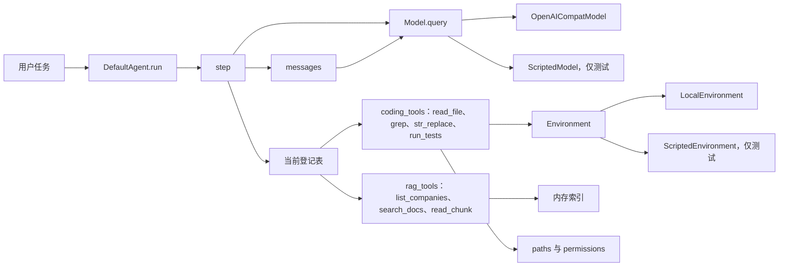
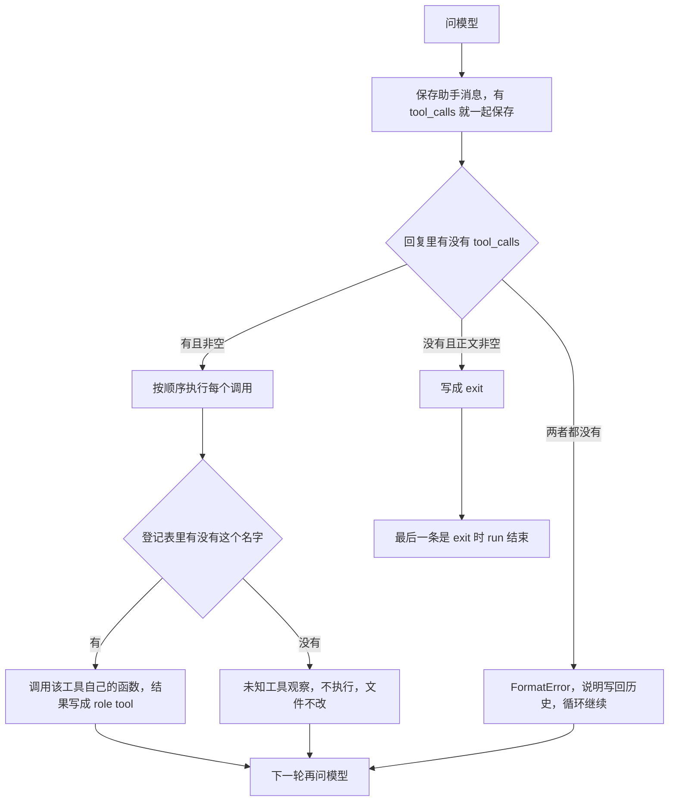

# 架构

同一套 `DefaultAgent.run` 负责循环。Coding 和 RAG 只在构造时换登记表，循环里不写工具名。

## 模块



`OpenAICompatModel` 只做格式转换：内部 `tool_calls` 的 `arguments` 是字典；发给接口时变成 JSON 字符串。`step` 不接触供应商对象。

没有传入 `tools` 时，默认登记表是 `echo` 加上 `coding_tools`。RAG 必须显式传入 `rag_tools(index)`，这样写文件和 shell 不在表里。

## 一轮 step



同一轮里的多个 `tool_calls` 按列表顺序执行。前一个的 `role="tool"` 先写入历史，再执行下一个。某一个失败不会取消后面的调用。

停止看的是有没有 `tool_calls`，不是正文是不是空的。模型可以一边解释一边调用工具。没有调用、正文也不是空的，才是最终回答。

## 一次 Coding 调用

```text
用户任务
  → 模型返回 read_file
  → Agent 读工作区内的文件，写入 role=tool
  → 模型返回 str_replace
  → 权限允许后改文件
  → 模型返回 run_tests
  → 命令先过 PermissionPolicy，再在工作区执行
  → 模型给出最终文本
  → run 结束
```

`str_replace` 在写入前调用 `ask_fn`。`run_tests` 先检查是否为测试命令，再走 `policy.decide`：命令以 `rm`、`del`、`format`、`shutdown` 开头，或包含 `..`，直接拒绝，不执行。

## 一次 RAG 调用

```text
用户问题
  → search_docs 在内存索引里按子串找片段编号
  → read_chunk 按编号返回正文
  → 最终回答只能来自读到的正文
```

用这张表去跑 Coding 剧本时，`str_replace` 不在表里，结果是「未知工具」，工作区文件保持原样。

## 历史里给模型看什么

客户端保存完整 `messages`，包括 `exit`。送给模型的列表只由 `to_model_messages` 产生：去掉 `exit`，留下 `role="tool"`。助手消息里的 `tool_calls` 会保留，这样下一条工具结果前面有对应的调用。

Steering 在下一次 `query` 之前插进当前历史。Follow-up 要等出现 `exit`、并且没有待处理的 steering，才作为新的用户消息继续。
